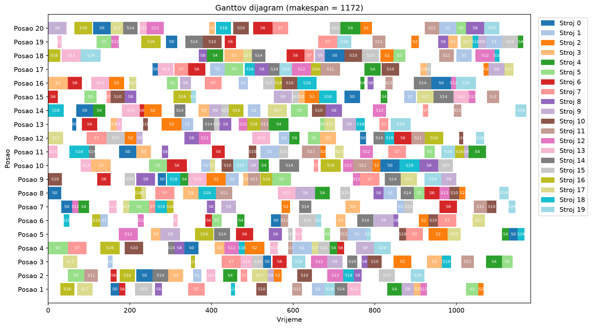
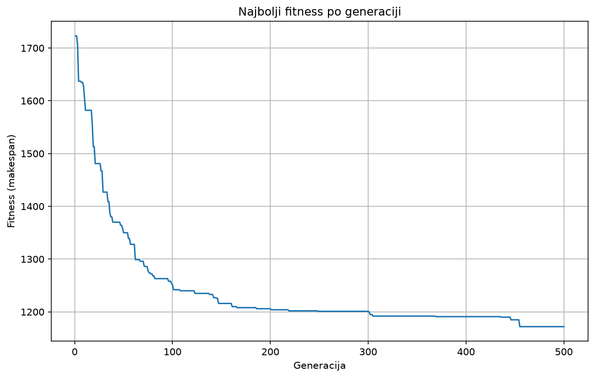

# Genetski algoritam za Job Shop Scheduling Problem

Implementacija genetskog algoritma (GA) u C++-u za rješavanje problema raspoređivanja
poslova (*Job Shop Scheduling Problem*, JSSP), uz Python skripte za vizualizaciju rezultata.



## Problem

Zadano je `n` poslova i `m` strojeva. Svaki posao se sastoji od `m` operacija koje se moraju
izvesti zadanim redoslijedom, svaka na određenom stroju i s određenim trajanjem. Stroj u
jednom trenutku može obrađivati samo jednu operaciju. Cilj je pronaći raspored koji
minimizira **makespan**, tj. vrijeme završetka posljednje operacije.

Zadana instanca je **yn4** (Yamada i Nakano, 20 poslova × 20 strojeva) iz
[OR-Library](http://people.brunel.ac.uk/~mastjjb/jeb/orlib/jobshopinfo.html).

## Algoritam

| Komponenta | Opis |
|---|---|
| Kodiranje | permutacija s ponavljanjem: svaki posao se u kromosomu javlja `m` puta, a k-to pojavljivanje označava njegovu k-tu operaciju |
| Dekodiranje | svaka operacija počinje čim su slobodni i stroj i prethodna operacija istog posla |
| Fitness | makespan (manji je bolji) |
| Selekcija | turnirska (zadano k = 3) |
| Križanje | POX (*Precedence Operation Crossover*), uvijek daje ispravnog potomka |
| Mutacija | zamjena dvaju gena, s vjerojatnošću po genu (zadano 0.001) |
| Elitizam | najbolje pronađeno rješenje uvijek prelazi u sljedeću generaciju |
| Resetiranje | svakih 10 generacija 30 % populacije zamjenjuje se slučajnim jedinkama radi raznolikosti |
| Paralelizam | fitness populacije računa se u više dretvi |

## Pokretanje

Potreban je C++20 prevoditelj (npr. GCC 10+).

```bash
make
./GA_JSSP                  # yn4, 50 jedinki, 500 generacija
./GA_JSSP -s 42 -g 5000    # fiksni seed (ponovljivi rezultati), 5000 generacija
./GA_JSSP -f data/jobshop1.txt -i ft10   # bilo koja instanca iz OR-Library datoteke
./GA_JSSP --pomoc          # sve opcije
```

Program ispisuje najbolji fitness po generaciji i sprema dvije CSV datoteke:

- `best_fitness_per_generation.csv`: `generacija,fitness`
- `best_schedule.csv`: `Job ID,Machine ID,Start Time,End Time`

### Opcije

| Opcija | Značenje | Zadano |
|---|---|---|
| `-f, --datoteka` | datoteka s instancom | `data/yn4.txt` |
| `-i, --instanca` | ime instance unutar datoteke (npr. `ft10`, `la01`, `yn1`) | prva u datoteci |
| `-p, --populacija` | veličina populacije | 50 |
| `-g, --generacije` | broj generacija | 500 |
| `-k, --turnir` | veličina turnira | 3 |
| `-m, --mutacija` | vjerojatnost mutacije po genu | 0.001 |
| `--reset-interval` | interval resetiranja (0 = isključeno) | 10 |
| `--reset-stopa` | udio populacije koji se resetira | 0.3 |
| `-s, --seed` | seed generatora slučajnih brojeva | slučajan |
| `-t, --dretve` | broj dretvi (0 = automatski) | 0 |
| `--izlaz-fitness`, `--izlaz-raspored` | putanje izlaznih CSV datoteka | vidi gore |

### Format instance

Koristi se standardni OR-Library format: u prvom retku su broj poslova i broj strojeva, a
zatim za svaki posao slijedi redak s parovima `stroj trajanje`:

```
20 20
16 34 17 38  0 21  6 15 ...
...
```

Datoteka može sadržavati i više instanci označenih retkom `instance <ime>`, kao `data/jobshop1.txt`.

## Vizualizacija

```bash
python3 -m venv .venv && source .venv/bin/activate
pip install -r requirements.txt

python skripte/graf.py best_fitness_per_generation.csv      # konvergencija jednog runa
python skripte/gantt.py best_schedule.csv                   # Ganttov dijagram
python skripte/graf_all.py rezultati/izvorna_verzija/runovi # usporedba više runova
```

Svaka skripta prima `-o slika.png` ako sliku treba spremiti umjesto prikazati.

## Rezultati (yn4)

Rezultati s 30 različitih seedova (`-s 1` … `-s 30`) uz zadane parametre (50 jedinki, 500 generacija):

| Najbolji | Medijan | Prosjek | Najgori | Trajanje runa |
|---|---|---|---|---|
| 1153 | 1201 | 1199.0 | 1251 | ≈ 0.3 s |



Za usporedbu, najbolja poznata rješenja za yn4 iz literature su ispod 1000. Ovaj jednostavni
GA bez lokalnog pretraživanja ne dolazi blizu njih.

Mapa `rezultati/izvorna_verzija/` sadrži 102 runa prve verzije programa. Ta je verzija
koristila križanje koje je uglavnom davalo neispravne potomke i mutaciju 0.3 po genu.
Najbolji makespan tamo je bio 1478, a prosjek 1579. Uz to je zbog prevođenja bez
optimizacija jedan run trajao oko 55 s.

## Struktura projekta

```
GA_JSSP.cpp              genetski algoritam
Makefile
data/
  yn4.txt                zadana instanca
  jobshop1.txt           82 instance iz OR-Library (ft, la, abz, orb, swv, yn ...)
  jobshop2.txt           generator Taillardovih instanci (ta01-ta80)
skripte/                 Python skripte za grafove
rezultati/
  primjer/               primjer runa trenutne verzije (seed 1)
  izvorna_verzija/       rezultati testiranja prve verzije
```

## Izvori podataka

Testne instance su iz OR-Library (J. E. Beasley). Instance su prikupili D. C. Mattfeld i
R. J. M. Vaessens. Instanca yn4 potječe iz rada: T. Yamada, R. Nakano (1992),
*A genetic algorithm applicable to large-scale job-shop problems*, PPSN II, 281–290.

## Licenca

[MIT](LICENSE)
